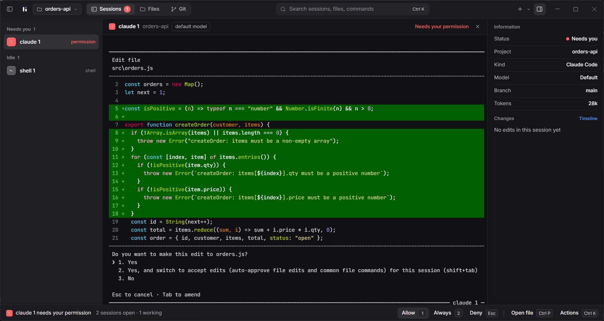
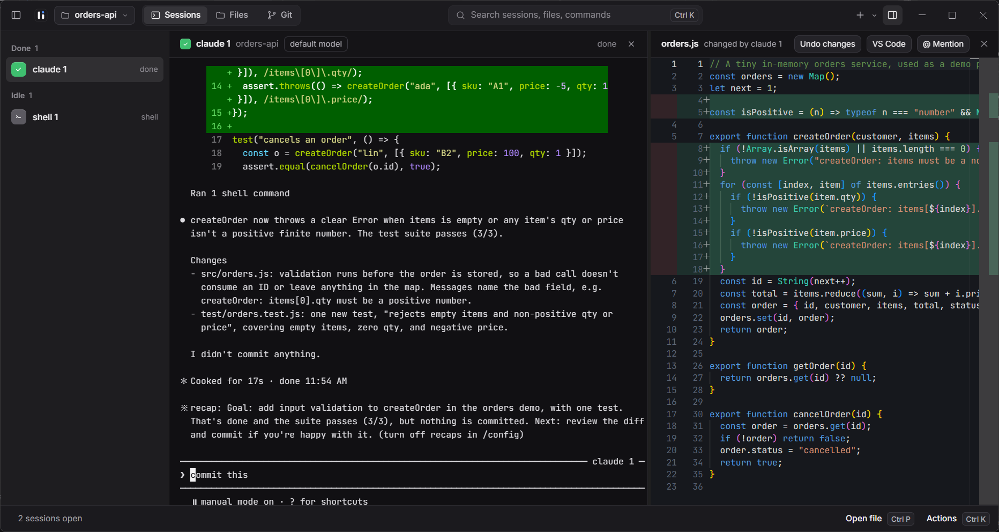
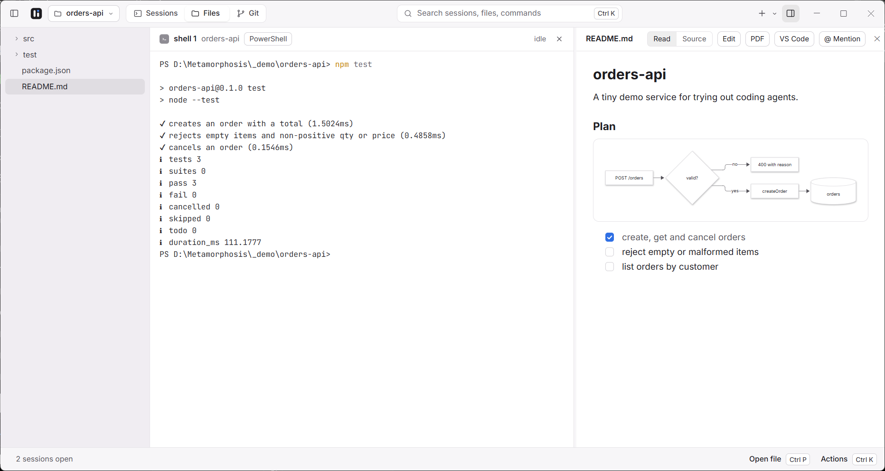

# Tando

A Windows desktop app for running several Claude Code sessions side by side. It answers one question first: **which session needs me now?**

Every session is a real terminal, so nothing hides behind a chat box. Around it sit a sessions list grouped by *Needs you*, *Working*, *Done* and *Idle*; an inspector with the files a session changed, as a diff with **Undo**; and a footer that answers a permission prompt with one key.



| | |
|---|---|
|  |  |
| Every file a session changed, as a diff with Undo. | Light theme, a PowerShell session and the Markdown reader. |

<sub>Screenshots use a small demo repository; the account usage panel is hidden.</sub>

## Install

1. Install the tools Tando drives (it tells you on its start screen if one is missing):
   - [Claude Code](https://claude.com/claude-code), signed in. It runs every session.
   - [Node.js](https://nodejs.org/en/download) 24 or newer. It reports each session's status.
   - [Git](https://git-scm.com/downloads/win). It powers changes, isolated sessions and source control.
2. Download `Tando-Setup-<version>.exe` from the [latest release](https://github.com/NITHV/meta-cli/releases/latest) and run it.
   The installer isn't code-signed, so Windows SmartScreen may warn you: choose **More info → Run anyway**.
3. Open Tando, pick a project folder, press **Ctrl+T**.

Tando needs no API key and makes no paid calls of its own: sessions run on your Claude Code login, and token counts are read from Claude's local logs.

## Use it

| Keys | |
|---|---|
| Ctrl+T / Ctrl+Shift+T | New Claude session / new PowerShell |
| Ctrl+J | Jump to the next session that needs you |
| Ctrl+1–9, Ctrl+Tab | Switch sessions |
| Ctrl+K | Command palette: everything else lives here |
| Ctrl+P | Open a file (Alt+Enter mentions it in Claude) |
| Ctrl+Shift+F | Search files and past Claude chats |
| Ctrl+Shift+G | Source control: stage, diff, commit, push |
| Ctrl+B / Ctrl+\\ | Toggle the sidebar / the reader |

- **Changes** lists every file the active session edited, with a diff and **Undo changes**. **Timeline** shows each edit with "Undo back to here".
- **Isolated session** gives Claude its own git branch and worktree; apply its work or open a PR when it's done.
- **Queue** runs tasks unattended, one by one, each in its own worktree, for review later.
- **Reader** renders Markdown with Mermaid diagrams and copy buttons; edit with live preview or export to PDF.
- Right-click a tab for **Continue in a new tab**; the **▾** next to **+** picks the model for new tabs.
- Light, dark and high-contrast themes, layouts, permission rules, snippets, notes per tab, and **phone access** to watch sessions and answer prompts from your phone on the same Wi-Fi (off by default, behind a secret link).

## How it works

Each tab is a real terminal (node-pty and xterm.js) running `claude` with a fixed `--session-id`, so tabs come back after a restart through `--resume`. Paused tabs use no memory until clicked. Status comes from Claude Code's own hooks (`--settings` with a hooks file), which ping the app over localhost: no screen scraping, so it doesn't break when Claude's interface changes.

## Build from source

```powershell
git clone https://github.com/NITHV/meta-cli; cd meta-cli\app
npm install
npm start                      # run Tando from source
npm run dist                   # build the installer into app\dist
```

`powershell -ExecutionPolicy Bypass -File app\install-shortcuts.ps1` adds Desktop and Start menu shortcuts for the source copy. Pushing a `v*` tag builds the installer on GitHub Actions and attaches it to a release.

---

## meta: the CLI underneath

The same repository has a CLI-first orchestrator for coding agents. Each run gets its own git worktree, so an agent never touches your working tree until you `apply`. Tando's Queue uses it.

```powershell
npm link                     # once, from the repo root: puts `meta` on PATH
cd <your repo>
meta agents
meta run "fix the failing test in parser.ts"
meta diff <run>; meta apply <run>   # or: meta discard <run>
meta runs

# same task, several agents in parallel, then keep the best
meta race "add input validation to add()" -a claude:haiku -a claude:sonnet
meta stats                   # success and keep rate per agent:model

meta ide                     # open Tando on the current folder (source copy)
meta serve                   # a small web IDE at http://localhost:4321
```

Requires Node 24+ and git. No dependencies: TypeScript runs directly through Node's type stripping, and state lives in `.meta/meta.db` (built-in `node:sqlite`).

### Design

- **Adapters** (`src/agents/`): each agent's headless mode is mapped onto one normalized event stream (`AgentEvent`). Adding an agent is one file. Claude Code, Antigravity (`agy`) and Gemini CLI are supported.
- **Isolation**: a run is a worktree at `.meta/worktrees/<id>` on branch `meta/<id>`, based on your HEAD. `apply` squash-merges it and leaves the changes staged for you to commit.
- **Safety**: by default agents may edit files but shell commands are denied (Claude `--permission-mode acceptEdits`, agy `--mode=accept-edits`). `--yolo` bypasses permissions; the worktree isolates files, not your machine.
- **State**: every run and event is in SQLite, so `meta show <run>` can replay it.
- **Web IDE**: `meta serve` binds to localhost and requires a random token (swapped for an HttpOnly SameSite=Strict cookie) plus an `X-Meta` header on writes, so other web pages can't drive it (CSRF and DNS-rebinding defense).
- **Race**: contestants run through a worker pool capped by `--max` (default 2), so a laptop with little RAM isn't swamped.

### Roadmap

- [x] `run`, `diff`, `apply`, `discard`, `show`, `runs`, `race`, `stats`
- [x] Adapters: Claude Code, `agy` (Antigravity CLI), `gemini` (paid API keys only)
- [x] Tando desktop app, with an installer built on GitHub Actions
- [ ] Codex adapter; agy over ACP
- [ ] Tando on macOS and Linux

## License

[MIT](LICENSE)
